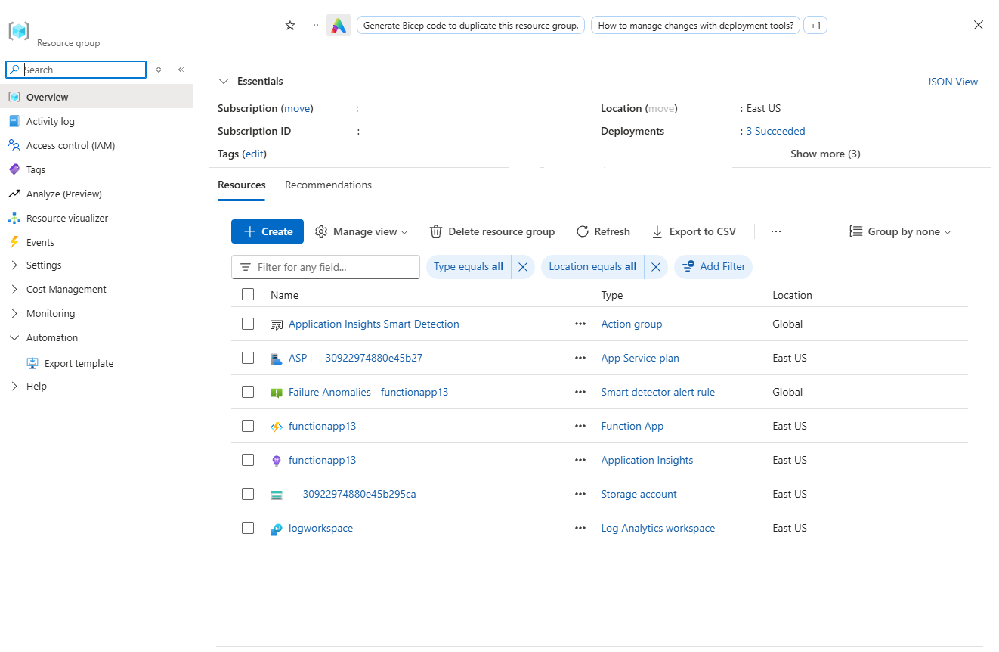
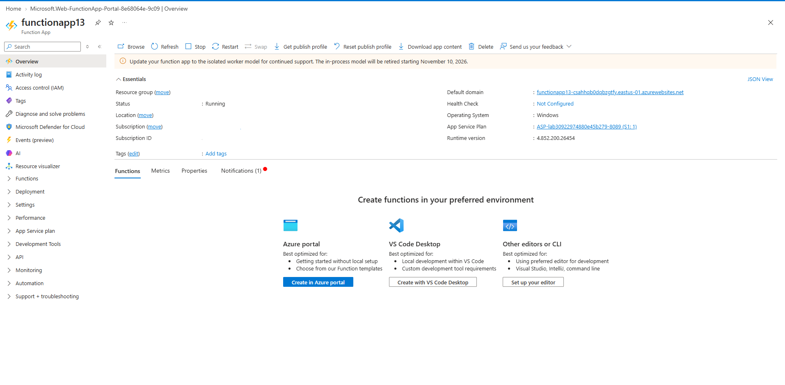
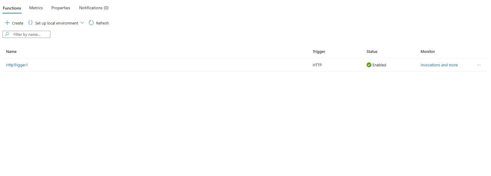
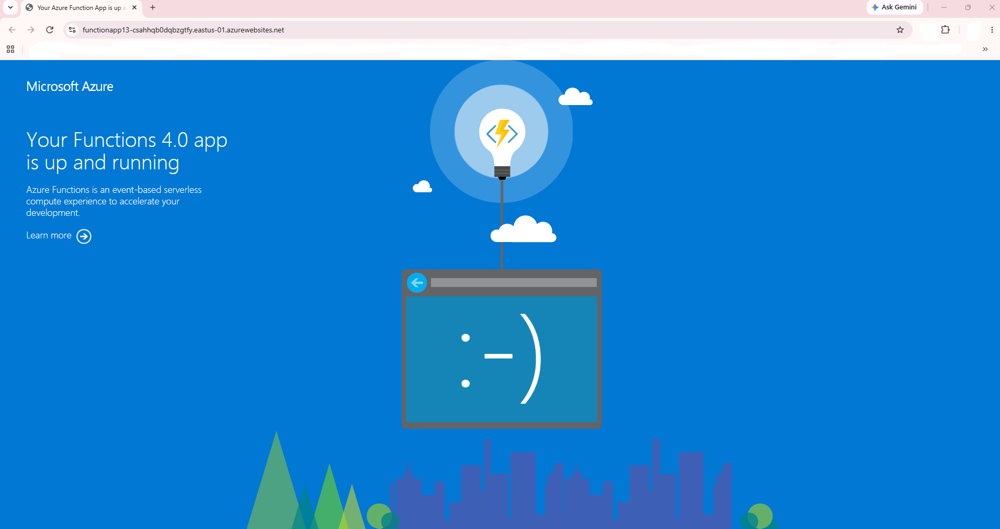
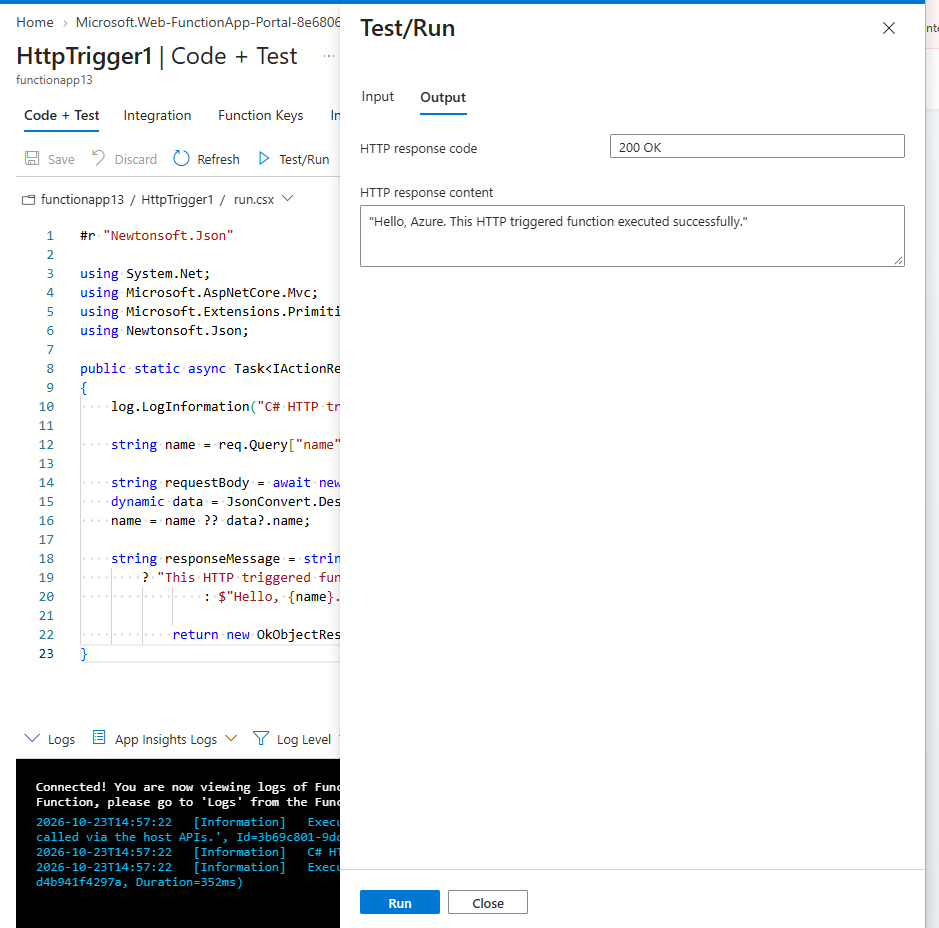
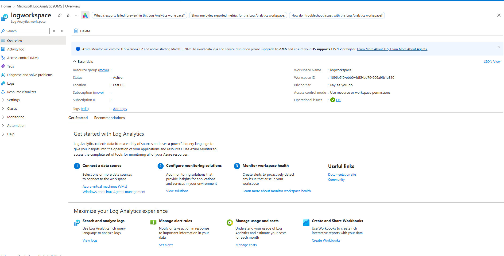

# Implement Azure Functions with HTTP Trigger
<br>

Comprehensive Azure serverless computing implementation demonstrating the creation of an Azure Function App, deployment of an HTTP-triggered function, validation of endpoint execution, and integration with Azure monitoring services including Application Insights and Log Analytics.
<br>

---
<br>

## 1. Architecture & Provisioned Resources
<br>

### Core Infrastructure Topology
<br>

| Resource Type | Resource Name | Purpose |
| :--- | :--- | :--- |
| **Azure Function App** | `functionapp13` | Hosts and executes serverless functions |
| **HTTP Trigger Function** | `HttpTrigger1` | Processes HTTP requests and returns responses |
| **App Service Plan** | `ASP-30922974880e45b27` | Compute infrastructure for Function App |
| **Storage Account** | `30922974880e45b295ca` | Stores function runtime data |
| **Application Insights** | `functionapp13` | Application monitoring and telemetry |
| **Log Analytics Workspace** | `logworkspace` | Centralized logging and diagnostics |

<br>

---

<br>

### Provisioned Environment Validation
<br>



<br>

*Resource group inventory confirming successful deployment of Azure Function App, App Service Plan, Storage Account, Application Insights, and Log Analytics Workspace.*

<br>

---

<br>

## 2. Azure Function Deployment
<br>

### Function App Overview
<br>

Created an Azure Function App to host serverless workloads and provide scalable HTTP-based execution.

<br>



<br>

*Azure Function App successfully deployed and running within the resource group.*

<br>

---

<br>

### HTTP Trigger Function Configuration
<br>

Created an HTTP-triggered Azure Function named **HttpTrigger1** to process incoming requests through a public endpoint.

<br>



<br>

*Function successfully created and enabled within the Azure Function App.*

<br>

---

<br>

## 3. Function Execution Verification
<br>

### Step 1: Validate Function App Endpoint
<br>

Accessed the Function App URL to verify successful deployment and runtime availability.

<br>



<br>

*Default Azure Functions landing page confirms the Function App is operational and accessible.*

<br>

---

<br>

### Step 2: Execute HTTP Trigger Function
<br>

Executed the function directly from the Azure Portal using the built-in Test/Run feature.

<br>



<br>

*Successful execution returned HTTP Status Code 200 (OK) with the expected response payload.*

<br>

### Response Output

```http
HTTP/1.1 200 OK

"Hello, Azure. This HTTP triggered function executed successfully."
```

<br>

---

<br>

## 4. Monitoring & Diagnostics Configuration
<br>

### Log Analytics Workspace
<br>

Configured a Log Analytics Workspace to collect and analyse telemetry and operational data generated by the Azure Function environment.

<br>



<br>

*Log Analytics Workspace provisioned successfully and ready for centralized monitoring and diagnostics.*

